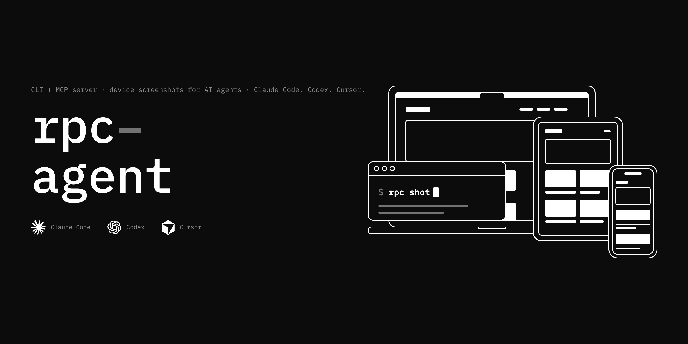
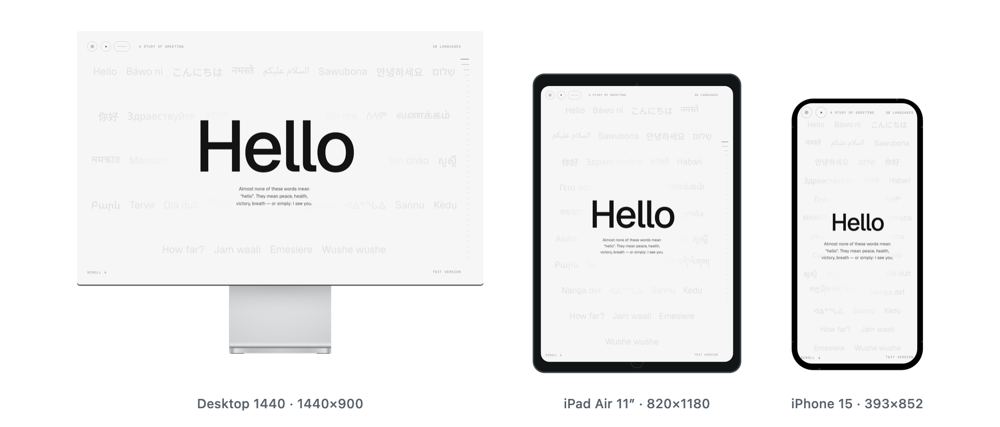
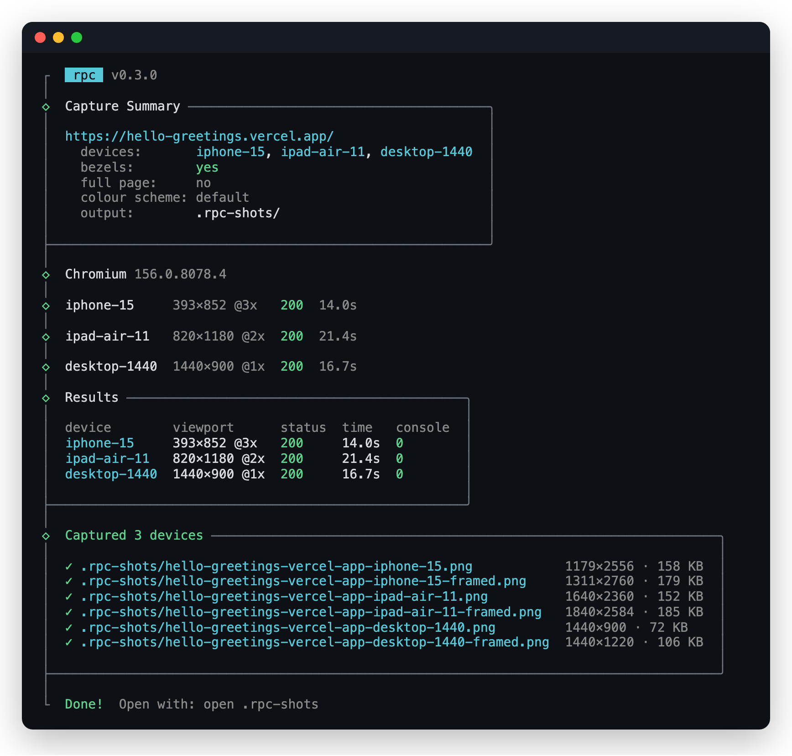
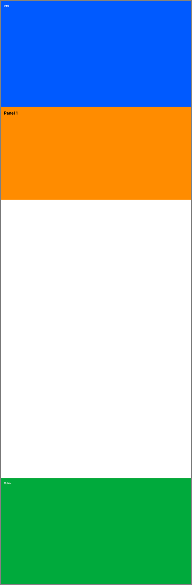
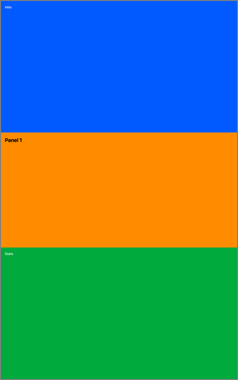
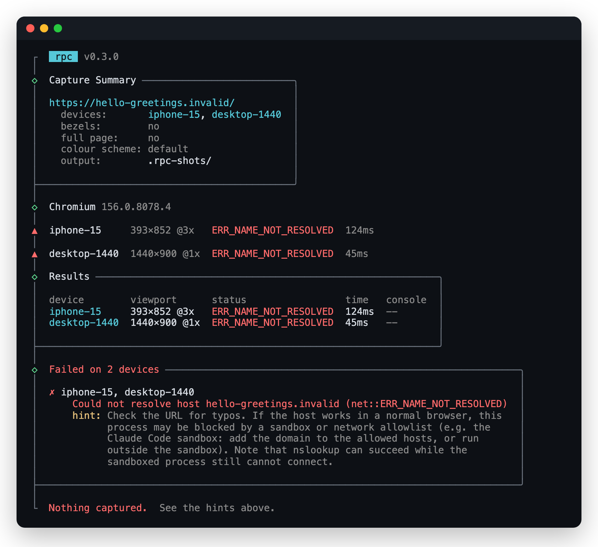
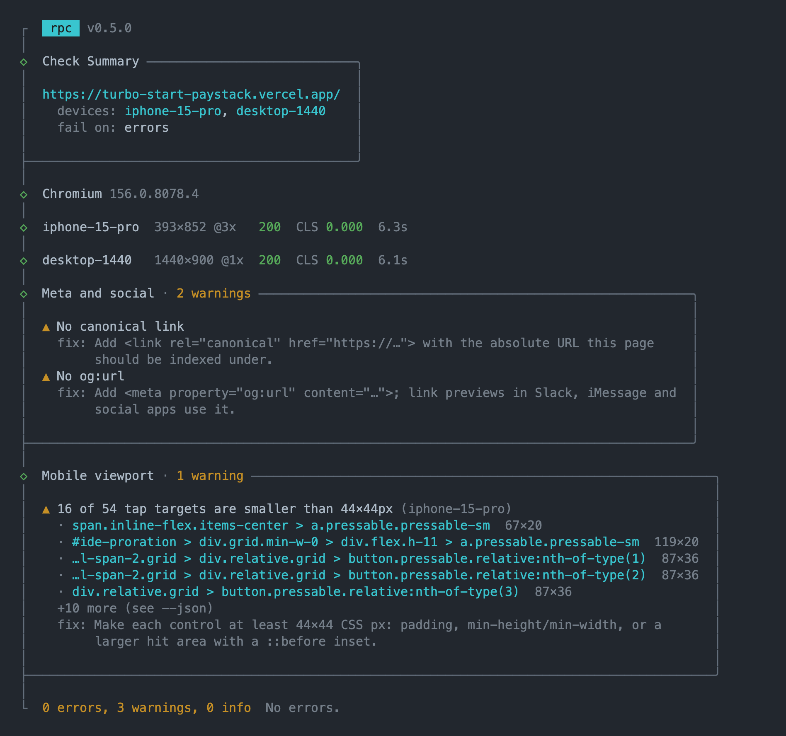
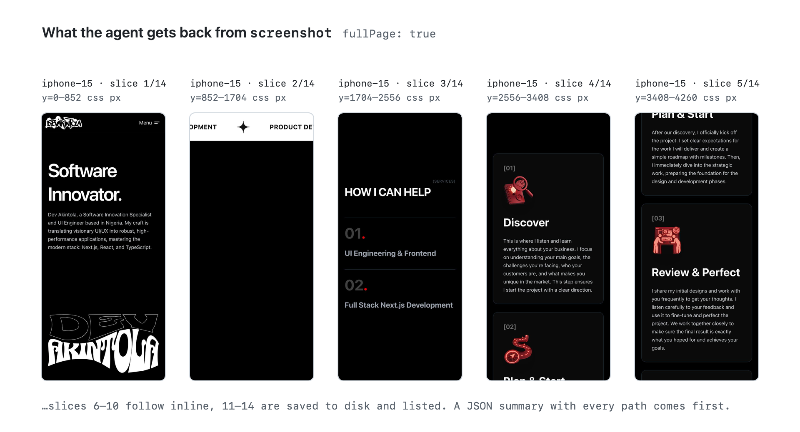

# rpc-agent



<picture>
  <source media="(prefers-color-scheme: dark)" srcset="https://raw.githubusercontent.com/akintola4/rpc-agent/main/docs/media/hero-dark.png">
  
</picture>

Screenshot a URL at real device viewports, optionally framed in a device
bezel, so an AI coding agent can look at the UI it just built. It's a CLI and
an MCP server in one package, with Playwright (Chromium) doing the capture.

The device catalog (49 phones, tablets, laptops and monitors) and the SVG
bezels come from the [Responsive Point Check](https://github.com/akintola4/responsive-point-check)
Chrome extension. See `NOTICE` for where the artwork comes from.

## Install

Requires Node 20.12 or newer. Run it without installing:

```sh
npx rpc-agent install          # first run: download headless Chromium (~210 MB on disk)
npx rpc-agent shot localhost:3000 -d iphone-15,desktop-1440 --bezels
```

Or install it globally to get the `rpc` command:

```sh
npm i -g rpc-agent
rpc install                    # first run: download Chromium
rpc doctor                     # checks Chromium is installed and launches
rpc shot https://example.com --bezels
```

Chromium is not downloaded when the package installs. `rpc install` (or
`npx rpc-agent install`) fetches it with rpc's own Playwright version, so
the browser always matches the one rpc launches. It installs only
Chromium's headless shell (plus Playwright's small ffmpeg), not the full
Chrome for Testing build, since captures never open a visible window
(`rpc install --headed` adds it for `rpc login`). Until you run it, every
command says Chromium is missing and prints that command, instead of
failing with Playwright's own error. Browsers go to Playwright's usual
cache, so other Playwright projects on the same version share them.

### From source

```sh
git clone https://github.com/akintola4/rpc-agent.git
cd rpc-agent
pnpm install && pnpm build
node dist/cli.js install
pnpm link --global             # optional: puts this build's `rpc` on your PATH
```

Without the link, run `node /absolute/path/to/rpc-agent/dist/cli.js` where
these docs say `rpc`, or `pnpm rpc` from inside the repo.

## CLI


```sh
rpc                    # interactive: pick a URL, devices and options
rpc shot <url> [options]
rpc check <url> [options]  # pre-launch audit, see Ship-check below
rpc record <url> [options] # a few seconds of video of the page or one element
rpc login <url> [--form]   # sign in once; later shots of that origin use the session
rpc sessions [list|clear [origin]]
rpc devices [--json]
rpc doctor [--json]    # is Chromium installed, and does it launch?
rpc install [--headed] # download Chromium with rpc's own Playwright version
rpc mcp
rpc help <command>     # options and examples for one command
```

Run `rpc` with no arguments in a terminal and it asks for the URL
(defaulting to a dev server on localhost:3000, 5173, 4321 or 8080 if one is
running), lets you tick devices from a grouped list (iPhone 15 Pro, iPad Air
11" and Desktop 1440 are preselected) and pick bezels, full page, dark mode
or reduced motion. It shows a summary, asks before capturing, and prints the
equivalent `rpc shot` command at the end so you can re-run it.

`rpc shot` in a terminal shows each device's progress, a results table and
the files it wrote:



| Option | Meaning |
| --- | --- |
| `-d, --devices <ids>` | Comma-separated device ids or aliases. Default `iphone-15-pro,desktop-1440` |
| `-b, --bezels` | Also write a copy framed in the device bezel |
| `-f, --full-page` | Capture the full scroll height, however tall (up to `--max-height`) |
| `--slices` | With `--full-page`, also write viewport-tall JPEG review slices |
| `--slice-width <px>` | Maximum slice width. Default 768 |
| `--max-height <px>` | Full-page cap in CSS px. Default 60000 |
| `--reduced-motion` | Emulate `prefers-reduced-motion: reduce` |
| `--finish-animations` | Jump animations to their end state before capturing. See [Animation-aware capture](#animation-aware-capture) |
| `--no-unpin` | With `--full-page`, keep pinned sections as they are instead of collapsing them |
| `-o, --out <dir>` | Output directory. Default `./.rpc-shots` |
| `--wait-for <selector>` | Wait for a visible element before capturing |
| `--wait <ms>` | Extra settle delay after load |
| `--color-scheme <s>` | `light`, `dark` or `no-preference` |
| `--timeout <ms>` | Navigation timeout. Default 30000 |
| `--no-emulate` | Viewport and DPR only: no mobile user agent or touch |
| `--json` | Print the result as JSON |
| `--open` | Open the output folder when done (`open`, `xdg-open` or `explorer`) |
| `--cookie <c>` | `name=value[; Domain=…; Path=…]`, repeatable. See [Authenticated pages](#authenticated-pages) |
| `--header <h>` | `Name: value`, repeatable, sent to the target origin only |
| `--storage-state <file>` | Load a Playwright storageState JSON |
| `--no-session` | Don't use the session saved by `rpc login` |
| `--allow-origin <o>` | Also send headers and loaded cookies to this origin, repeatable |

The URL can be a full URL, a bare local host (`localhost:3000` becomes
`http://`), a bare domain (`example.com` becomes `https://`) or a path to a
local `.html` file.

```sh
rpc shot localhost:3000 -d iphone-15,ipad,desktop-1440 --bezels
rpc shot https://example.com/pricing --full-page --slices --color-scheme dark
rpc shot localhost:5173 -d pixel --wait-for '[data-ready]' --json
```

Output files are named `<host>[-<path>]-<device>.png`, with `-framed.png`
for bezel copies and `-slice-NN.jpg` for slices, for example
`.rpc-shots/localhost-3000-iphone-15.png`. Re-running overwrites them, so the
paths stay the same between runs.

Aliases: `iphone`, `mobile`, `phone` (iphone-15-pro), `android`, `pixel`
(pixel-8), `galaxy` (galaxy-s24), `ipad`, `tablet` (ipad-air-11), `macbook`
(macbook-air-13), `laptop` (laptop-1280), `desktop` (desktop-1440), `imac`
(imac-24). Run `rpc devices` for the full list.

### What a capture does

Each device gets a fresh browser context with its CSS viewport, device pixel
ratio and, for phones and tablets, a mobile user agent plus touch. The page
loads, then rpc waits for network idle (up to 10 s, so dev servers with HMR
sockets don't hang it), web fonts and pending images. CSS animations,
transitions and Web Animations are finished before the shot.

With `--full-page`, rpc first scrolls through the page one viewport at a time
so lazy images and IntersectionObserver content load, then scrolls back to
the top. A page that fits in one Chromium capture (16,384 device px) is taken
in one pass. A taller one is taken as clipped segments of about 8,000 device
px and stitched into one PNG in Node, with no height limit apart from
`--max-height` (60,000 CSS px by default; taller pages are cut there and
marked `clipped`). Both paths render the page as if the viewport were the
whole document, so sticky headers and fixed elements appear once, at the top,
and `100vh` sections keep their real height.

Bezels frame the above-the-fold viewport. With `--bezels --full-page` you get
both: the full page raw, and the first screen framed.

### Animation-aware capture

A stitched shot of a page with scroll animations used to come out wrong in
three ways: pinned scroll sections left tall blank bands, text was caught
halfway through its reveal, and carousels froze on whatever slide was up.

#### Settle

Before each capture, and at every step of the full-page warm-up
scroll, rpc waits until the visible part of the page stops moving: no
finite animation running on a visible element, and no `style` or `class`
change on one for 150 ms (120 ms per warm-up step). It gives up after 2 s
(800 ms per step, 8 s for the whole warm-up), so a page that never stops
can't hang it. Anything still changing when a step runs out of time is
treated as a loop (a JS marquee, a ticker), and later steps stop waiting for
it. A static page only pays the quiet period. The result is on each shot as
`motion.settle`: `settled`, `ms`, and the selectors still active.

#### Pinned sections

GSAP ScrollTrigger pins a section by wrapping it in a
`.pin-spacer` with padding below it, then fixing the section in place while
you scroll through that padding. A full-page capture renders the page at
scroll 0, where the section sits at the top of its spacer and the padding
is empty, so the shot gets a blank band as tall as the pin's scroll
distance. With `--full-page`, rpc collapses each pin it finds. The spacer
loses its padding, the section goes back into normal flow, and the shot
shows it once with the rest of the page right after it. A sticky section
that is the only child of a much taller parent gets the same treatment. The
rules go in an injected stylesheet as `!important`, so when the library
rewrites its inline styles during the capture, they still win. Each
collapsed pin is listed in `motion.unpinned` with the CSS px removed, and
the stitched height is measured after the collapse. `--no-unpin` turns it
off.

| `--no-unpin` (before) | default (after) |
| --- | --- |
|  |  |

#### Finish animations

`--finish-animations` calls `.finish()` on every finite Web Animation,
which covers CSS animations and transitions too. If `window.gsap` exists,
tweens and timelines on its global timeline that don't repeat forever go to
`progress(1)`. If `window.ScrollTrigger` exists, triggers that aren't
scrubbed or pinned get their animation set to `progress(1)`. Scrubbed and
pinned ones follow the scroll position, so they keep their scroll-0 state.
Each library step runs in its own try/catch and does nothing when the
library isn't there. Infinite loops are left alone. The counts are in
`motion.finished`.

#### Reduced motion

`--reduced-motion` still emulates
`prefers-reduced-motion: reduce`. On a site that respects it, that's the
cleanest fix, because the animations never run.

#### Warnings

Each shot gets a `warnings` list in the JSON, and the terminal
prints them under the device:

```
ok desktop-1440 (1440x900 @1x)
   .rpc-shots/localhost-3000-desktop-1440.png  1440x900
   warn: 1 element was still animating when captured: h1.hero-title
   warn: carousel: use `rpc record` for motion: #carousel
```

| id | When |
| --- | --- |
| `motion-running` | Elements were still animating or changing when the settle ran out of time: "N elements were still animating when captured" |
| `motion-pinned` | Full page only. A pin was left in place (`--no-unpin`, or one that couldn't be collapsed): "pinned section: the stitched shot may show blank space" |
| `motion-reveal-hidden` | Content still at opacity 0, or offset by 24px or more, that looks like a reveal (see [Motion](#motion)) |
| `motion-carousel` | A carousel or marquee is in the shot: "carousel: use `rpc record` for motion" |

Each warning has a `fix` naming the flag to try. Warnings never change the
exit code.

### Terminal, pipes and CI

The banner, spinners, prompts and boxes only appear when stdout is an
interactive terminal. When output goes to a pipe or a file, when `CI` is
set, when `TERM=dumb`, and always with `--json`, rpc prints the same plain
lines as 0.2 (`ok …`, `x …` plus `hint:`), so agents and scripts that read
them see no change. `NO_COLOR` turns colour off; `FORCE_COLOR=1` adds colour
to the plain lines. `rpc mcp` never prints anything but MCP messages.

### When a capture fails

Each device fails on its own, with an `error`, a `code` and usually a `hint`.
In a terminal, devices that fail the same way share one hint:



Plain output (pipes, agents, CI):

```
x iphone-15 (393x852 @3x): Could not resolve host example.dev (net::ERR_NAME_NOT_RESOLVED)
   hint: Check the URL for typos. If the host works in a normal browser, this process may be
   blocked by a sandbox or network allowlist (e.g. the Claude Code sandbox: add the domain to
   the allowed hosts, or run outside the sandbox). ...
```

Covered: DNS failures, refused connections (on localhost: "nothing is
listening on port N"), proxy, tunnel and offline errors, TLS errors (https
against a plain-http dev server), missing files, redirect loops, navigation
and `--wait-for` timeouts.

## Authenticated pages

Dashboards, billing and settings pages sit behind a login. rpc can carry a
session so you don't need a hand-written "sign in, then screenshot" script.

### Sign in once with `rpc login`

```sh
rpc login localhost:3000/sign-in
rpc shot localhost:3000/app/settings/billing -d iphone-15,desktop-1440 --bezels
```

`rpc login` opens a browser window at the URL. Sign in as you normally
would (SSO and 2FA work, it's a real browser), then press Enter in the
terminal or close the window. rpc saves the browser's storage state
(cookies and localStorage) to
`~/.config/rpc-agent/sessions/<origin>.json`, for example
`http-localhost-3000.json`. From then on, `rpc shot` on that origin uses it
automatically, and the output says so:

```
auth: session http://localhost:3000 (saved 2026-10-29 22:55)
ok iphone-15 (393x852 @3x)
```

The window needs full Chromium, which `rpc install` doesn't download (it
fetches only the headless shell). Run `rpc install --headed` once, or have
Google Chrome installed; rpc falls back to it.

`--save <file>` writes the storage state to a file of your choice instead;
use it with `rpc shot --storage-state <file>`.

```sh
rpc sessions                      # origins, cookie counts, saved and expiry times
rpc sessions clear localhost:3000 # forget one origin
rpc sessions clear                # forget all
rpc shot localhost:3000/app --no-session   # capture as a signed-out visitor
```

### When the session is missing or expired

If the page redirects to a login URL (a path segment like `/login`,
`/sign-in`, `/signin` or `/auth`, different from the one you asked for),
rpc doesn't screenshot the sign-in form. The device fails with code
`AUTH_REQUIRED`:

```
x iphone-15 (393x852 @3x): Redirected to a login page (http://localhost:3000/sign-in) instead of http://localhost:3000/app/settings/billing
   hint: Session missing or expired: run `rpc login http://localhost:3000`
```

A saved session whose cookies have all passed their expiry isn't loaded,
and gives the same hint.

### CI and agents: `rpc login --form`

Without a person at the keyboard, `--form` signs in headlessly through a
standard email + password form:

```sh
export RPC_LOGIN_EMAIL=ci@example.test
export RPC_LOGIN_PASSWORD=...        # from your CI secret store
rpc login https://staging.example.com/sign-in --form
rpc shot https://staging.example.com/app/billing --json
```

It loads the page, waits for it to settle (so a client-side form has
hydrated), fills the first match of `--email-selector` (default
`input[type=email]`, then `autocomplete=username`, `name=email`,
`name=username`, `#email`) and `--password-selector` (default
`input[type=password]`), clicks `--submit-selector` (default
`button[type=submit], input[type=submit]`, or presses Enter if there is no
button), and waits for the URL to leave the login page. If it doesn't
within `--timeout`, it fails and quotes any alert the page shows ("Invalid
email or password"). `--email` works as a flag too; see the security notes
before using `--password`.

### Cookies and headers

```sh
rpc shot localhost:3000/app --cookie "session=$SESSION"
rpc shot app.example.com/admin --cookie "sid=$SID; Domain=example.com; Path=/"
rpc shot api.example.com/docs --header "Authorization: Bearer $TOKEN"
rpc shot localhost:3000/app --storage-state auth.json
```

- `--cookie` is host-only on the target unless you give a `Domain`, which
  must match the target host (or an `--allow-origin` host). `Secure`,
  `HttpOnly` and `SameSite` are accepted too.
- `--header` is sent only on requests to the target origin. Images,
  scripts and API calls to other origins don't get it, and neither does a
  redirect to another host (every redirect hop is checked).
- `--storage-state` and saved sessions load only the target origin's
  cookies and localStorage, even if the file holds others (an SSO domain,
  analytics).
- `--allow-origin https://api.example.com` widens all of the above to
  another origin, for an app that calls a separate API host.
- A saved session is used unless `--no-session` or `--storage-state` is
  given. Cookies and headers are added on top of it.

### Security notes

- **Values are never printed.** Plain, rich and `--json` output and MCP
  results show cookie and header names with `•••`. Console errors and
  failure messages are scrubbed of every value rpc injected. The `--json`
  result gains an `auth` field, for example
  `{"cookies":[{"name":"sid","value":"•••","domain":"localhost","path":"/"}]}`.
- **Session files are credentials.** They are written with mode 0600 in a
  0700 directory (`$XDG_CONFIG_HOME/rpc-agent/sessions` if set;
  `RPC_SESSIONS_DIR` overrides the location). Anyone who can read one can
  act as you on that site until it expires. `rpc sessions clear` deletes
  them. Don't commit a `--save` file.
- **Keep passwords out of shell history.** Prefer `RPC_LOGIN_PASSWORD` from
  a secret store over `--password`, which lands in your shell history and
  is visible to other users in the process list; rpc warns when you use it.
  The same goes for tokens in `--cookie` and `--header`: pass them from an
  environment variable (`--header "Authorization: Bearer $TOKEN"`), not
  literally.
- **Use a test account.** Sign in as a user whose data you're happy for
  screenshots (and the agent reading them) to see.

## Ship-check

`rpc check <url>` audits one page before you call it done. It loads the page
on a phone and a desktop width, the way `rpc shot` does, and lists what's
wrong: missing or broken social tags, layout shift, buttons a screen reader
can't name, fonts that hide text while they load, the mobile viewport bugs
that only show up on a phone, and motion a screenshot will get wrong.

```sh
rpc check localhost:3000
rpc check localhost:3000 --fail-on warn --json     # CI
rpc check example.com/pricing -d pixel,iphone-se,desktop --shots
```



URLs, devices and auth work as in `rpc shot`: `localhost:3000` needs no
scheme, `-d` takes ids or aliases (default `iphone-15-pro,desktop-1440`),
and `--cookie`, `--header`, `--storage-state` and the session saved by
`rpc login` all apply. A page that redirects to a login URL fails with
`AUTH_REQUIRED`. Each run checks one URL. It isn't Lighthouse: CLS is the
only performance number it reports.

| Option | Meaning |
| --- | --- |
| `-d, --devices <ids>` | Devices to check on. The mobile checks run on phones only |
| `--fail-on <level>` | `error` (default) exits 1 on errors; `warn` exits 1 on warnings too |
| `--shots` | Save PNGs of the elements behind layout-shift and overflow findings into `--out` |
| `-o, --out <dir>` | Where `--shots` writes. Default `./.rpc-shots` |
| `--json` | Print the report as JSON (see below) |
| `--wait-for`, `--wait`, `--timeout`, `--color-scheme` | As in `rpc shot` |
| `--cookie`, `--header`, `--storage-state`, `--no-session`, `--allow-origin` | As in `rpc shot` |

The exit code is 0 when there are no errors (with `--fail-on warn`, no
warnings either), 1 otherwise and 2 for a usage error.

### How a check runs

Each device gets a fresh browser context, the same one `rpc shot` uses.
Before the page's own scripts run, rpc installs a `PerformanceObserver` for
`layout-shift`. It loads the page and waits for network idle (up to 10 s),
web fonts and pending images. Then it waits a fixed 500 ms, scrolls down one
viewport and back with a 300 ms pause each way, and reads the page. Because
the sequence is fixed, CLS comes out the same on every run; the tests check
the same page twice and allow 0.005 of difference.

When a finding is identical on several devices it's reported once, with
every device listed, so a missing `lang` appears one time, not two.

### What it checks

Severity decides the exit code. `error` fails the run, `warn` fails it only
with `--fail-on warn`, and `info` never does.

#### Basics

| id | Severity | When | Fix |
| --- | --- | --- | --- |
| `http-status` | error | The page answered 400 or above | Serve it with a 200 |
| `page-load-failed`, `auth-required` | error | The page didn't load on a device (DNS, refused, timeout) or landed on a login page | The error's own hint, e.g. ``run `rpc login <origin>` `` |
| `mixed-content` | error (warn if the browser upgraded every request) | `http://` requests on an https page | Load everything over https |
| `uncaught-exception` | error | Exceptions thrown during load, first three listed | Fix the first one; the rest often follow from it |
| `console-errors` | warn | `console.error` during load: the count and the first three | Fix or silence them |
| `theme-color-missing` | info | No `<meta name="theme-color">` | Add one to tint the mobile browser bar |

#### Meta and social

| id | Severity | When | Fix |
| --- | --- | --- | --- |
| `title-missing`, `title-long` | error, warn | No `<title>`, or one over 60 characters | 50 to 60 characters, key words first |
| `description-missing`, `description-long` | warn, info | No meta description, or one over 160 characters | One or two sentences |
| `canonical-missing` | warn | No `<link rel="canonical">` | The absolute URL to index |
| `lang-missing` | error | No `lang` on `<html>` | `<html lang="en">` |
| `viewport-missing`, `viewport-no-zoom` | error | No viewport meta, or one with `user-scalable=no` or `maximum-scale` under 2 | `width=device-width, initial-scale=1` and nothing that blocks zoom |
| `favicon-missing` | warn | No `<link rel="icon">`, and `/favicon.ico` doesn't load | Add an icon link |
| `apple-touch-icon-missing` | info | No `apple-touch-icon` | A 180x180 PNG |
| `og-title-missing`, `og-description-missing`, `og-image-missing`, `og-url-missing` | warn | That Open Graph tag is absent | Add it; link previews read it |
| `twitter-card-missing` | warn | No `twitter:card` | `summary_large_image` |
| `og-image-relative` | warn | `og:image` isn't an absolute URL | Make it absolute; most scrapers don't resolve relative URLs |
| `og-image-broken`, `og-image-not-image` | error | `og:image` doesn't return 200, or isn't served as an image | Point it at the image file |
| `og-image-small`, `og-image-ratio` | warn, info | Smaller than 600x315, or not the 1.91:1 shape of 1200x630 | Export it at 1200x630 |

rpc fetches `og:image` once per run and reads its pixel size from the file
header (PNG, JPEG, GIF or WebP). The result is in the report's `ogImage`.

#### Layout shift

| id | Severity | When | Fix |
| --- | --- | --- | --- |
| `layout-shift` | error above 0.25, warn above 0.1, info above 0 | CLS for the load and the scroll, with the three elements that moved most and each one's share | Reserve space for late content: `width`/`height` or `aspect-ratio` on media, `min-height` on async sections, nothing inserted above what's on screen |

The score is computed the way Chrome computes it: the largest session
window, meaning shifts less than 1 s apart and at most 5 s in total. Chrome
marks shifts that follow input as `hadRecentInput`, including any in the
first 500 ms after navigation, and those don't count. Totals under 0.001
count as zero. Each device's score is also in `devices[].cls`.

#### Unlabelled controls

| id | Severity | When | Fix |
| --- | --- | --- | --- |
| `button-no-name`, `link-no-name` | error | A button, link or `[role=button]` with no accessible name, such as an icon-only button | `aria-label`, visually hidden text, or alt text on the image inside |
| `img-no-alt` | error | An `` with no `alt` attribute (`alt=""` is fine) | Describe the image, or `alt=""` if it's decorative |
| `field-no-label` | error | An input, select or textarea with no label | `<label for>`, a wrapping `<label>`, or `aria-label` |
| `field-placeholder-only` | warn | A field labelled only by its placeholder | Add a visible label |

rpc works out accessible names in the page from `aria-labelledby`,
`aria-label`, `<label>`, `alt`, the text inside (minus anything
`aria-hidden`), an SVG `<title>` and `title`. It skips elements assistive
tech can't reach: `display: none`, `visibility: hidden`, `aria-hidden` and
`inert`.

#### Fonts

| id | Severity | When | Fix |
| --- | --- | --- | --- |
| `font-display-missing`, `font-display-block` | warn | A loaded `@font-face` has no `font-display` (Chrome then hides its text for up to 3 s) or uses `block`. The message says when it sets text above the fold (FOIT) | `font-display: swap` or `optional`; `&display=swap` for Google Fonts |
| `font-not-preloaded` | warn | A font file that sets text in the first viewport isn't preloaded | `<link rel="preload" as="font" type="font/woff2" crossorigin>` |
| `font-preload-no-crossorigin` | warn | A font preload without `crossorigin`, so the file downloads twice | Add `crossorigin` |
| `font-preload-unused` | info | A preloaded font that no `@font-face` uses | Remove it, or match the URL exactly |
| `font-failed` | error | A font file returned 400 or above | Fix the `src` URL |

Every font finding names the file URL. The `@font-face` rules come from the
page's stylesheets; the page can't read cross-origin ones (Google Fonts, a
CDN), so rpc downloads and parses those itself. Faces with only `local()`
sources, like next/font's size-adjusted fallbacks, never block text and are
skipped.

#### Mobile viewport

These run on phone devices only.

| id | Severity | When | Fix |
| --- | --- | --- | --- |
| `horizontal-overflow` | error | `scrollWidth` is wider than the layout viewport. Lists the outermost elements that stick out, furthest first | `max-width: 100%` on the element, or `overflow-x: auto` on its wrapper |
| `vh-units` | warn | A rendered element sized with `100vh` in `height`, `min-height` or `max-height`, from a stylesheet rule that applies or an inline style | `100dvh` or `100svh`, with `100vh` before it as a fallback |
| `tap-target-small` | warn | Links, buttons and form controls smaller than 44x44 CSS px. Inline links in a sentence are exempt, per the WCAG 2.5.8 inline exception: a link with `display: inline` and other text in the same block. Buttons and links laid out as boxes (`inline-block`, `flex`, `block`) still count | Padding, `min-height`, or a bigger hit area |
| `input-zoom` | warn | A text field with `font-size` under 16px; iOS Safari zooms the page when it gets focus | `font-size: 16px` or more |

A headless phone has no browser bars, so `100vh` and `100dvh` measure the
same there. That's why `vh-units` reads the CSS instead of measuring
elements. The `height: 100vh; height: 100dvh` fallback pattern isn't
flagged: the browser keeps only the last value it understands.

#### Motion

After the scroll, rpc gives running animations up to 1 s to stop, then
looks at the viewport plus half a viewport above and below. These findings
are about whether a screenshot comes out right, and a page can ship with
them, so they are `warn` or `info` and never `error`.

| id | Severity | When | Fix |
| --- | --- | --- | --- |
| `motion-running` | warn | Finite animations (from `document.getAnimations()`) or style changes still going on visible elements | `rpc shot --finish-animations`, `--wait`, or `--reduced-motion` |
| `motion-reveal-hidden` | warn | Elements with text or media at opacity under 0.1, `visibility: hidden`, offset by 24px or more, or scaled under 0.85, that also carry a reveal class (`reveal`, `fade`, `aos`, `in-view`, `animate` and similar), a reveal attribute (`data-aos`, `data-sal`, `data-scroll` and similar) or inline opacity or transform written by a library. Only the outermost element is listed | Make sure the reveal fires, and that the content shows without JavaScript or animation |
| `motion-loop` | info | Infinite animations: spinners, pulses, CSS marquees | Stop them under `prefers-reduced-motion: reduce` |
| `motion-pinned` | info | A `.pin-spacer` taller than its section by a quarter of the viewport, a pin that `ScrollTrigger.getAll()` reports, or a sticky or fixed section (half a viewport tall or more) that is the only child of a parent at least half a viewport taller | `rpc shot --full-page` collapses it; `rpc record --selector` shows it moving |
| `motion-carousel` | info | Swiper, Embla, Splide, Keen, Flickity, Slick or Glide roots, `aria-roledescription="carousel"`, horizontal scrollers with `scroll-snap-type` on x, and tracks whose scroll position or transform changes during a 300 ms sample | `rpc record <url> --selector '<the carousel>'` |

### JSON report

`--json` prints this object, and the MCP `check` tool returns the same one.
`schema` goes up only when a field changes meaning or is removed; new fields
can appear without it.

```jsonc
{
  "schema": 1,
  "url": "https://example.com/",
  "devices": [
    {
      "device": "iphone-15-pro",
      "name": "iPhone 15 Pro",
      "viewport": { "width": 393, "height": 852 },
      "dpr": 3,
      "mobile": true,              // the phone-only checks ran here
      "status": 200,
      "finalUrl": "https://example.com/",
      "title": "Example",
      "cls": 0.012,
      "layoutShifts": 2,
      // only when the page didn't load on this device:
      "error": "…", "code": "ERR_NAME_NOT_RESOLVED", "hint": "…"
    }
  ],
  "summary": { "errors": 1, "warnings": 4, "info": 2 },
  "findings": [
    {
      "id": "horizontal-overflow",      // stable; see the tables above
      "check": "mobile",                // basics | meta | layout-shift | labels | fonts | mobile
      "severity": "error",              // error | warn | info
      "message": "The page scrolls sideways: 601px wide in a 393px viewport",
      "fix": "Find the element that sticks out …",
      "devices": ["iphone-15-pro"],
      "selector": "div.pricing-table",  // when one element is the answer
      "url": "…",                       // when a file is (a font, og:image)
      "value": 208,                     // the number behind it, if there is one
      "items": [                        // elements, files or log lines, when there are several
        {
          "selector": "div.pricing-table",
          "text": "600px wide, 207px past the edge",
          "value": 207,
          "screenshot": "/abs/.rpc-shots/…-check-horizontal-overflow-1.png"  // with --shots
        }
      ]
    }
  ],
  "ogImage": { "url": "…", "status": 200, "contentType": "image/png", "width": 1200, "height": 630 },
  "auth": { … }                         // as in rpc shot, values masked
}
```

Findings are sorted by check, in the order of the tables above, then by
severity. `id`, `check`, `severity`, `message`, `fix` and `devices` are
always there; the other fields appear when they apply.

### In CI

```sh
npx rpc-agent install
npx rpc-agent check https://staging.example.com --fail-on warn --json > ship-check.json
```

The exit code fails the job, and the JSON can go into a PR comment or a
build artifact. For a page behind a login, sign in first with
`rpc login <url> --form` (see [CI and agents](#ci-and-agents-rpc-login---form)).

### With a coding agent

Add the MCP server (below) and tell the agent to run `check` before it
reports UI work as finished, for example in `CLAUDE.md` or `AGENTS.md`:

```md
Before you say UI work is done, run the rpc `check` tool on each page you
changed and fix every error. Fix the warnings too, or say why one doesn't apply.
```

## Recording motion: `rpc record`

A still can't show a carousel, a marquee, or a pinned section whose panels
slide as you scroll. `rpc record` takes a few seconds of video of the page,
or of one element on it.

```sh
rpc record localhost:3000 --selector '.hero-carousel'     # 5 s of one element
rpc record localhost:3000 -d iphone --duration 10 --gif   # whole phone viewport, plus a GIF
rpc record example.com --selector '#logos' --mp4          # mp4 too, if ffmpeg is on PATH
```

| Option | Meaning |
| --- | --- |
| `--selector <css>` | Record this element. rpc scrolls it into view, waits for reveals around it to settle, and crops the video to its box. If it's bigger than the viewport, the visible part is recorded and the result says so |
| `--duration <s>` | Seconds of video, 0.5 to 30. Default 5 |
| `-d, --device <id>` | One device id or alias. Default `desktop-1440` |
| `--gif` | Also write a GIF: 10 fps, at most 640 px wide |
| `--mp4` | Also write an mp4. This needs an ffmpeg with an H.264 encoder on PATH; without one, rpc skips the mp4 and says so |
| `-o, --out <dir>`, `--json`, `--open` | As in `rpc shot` |
| `--wait-for`, `--wait`, `--timeout`, `--color-scheme`, `--reduced-motion`, `--no-emulate` | As in `rpc shot` |
| `--cookie`, `--header`, `--storage-state`, `--no-session`, `--allow-origin` | As in `rpc shot` |

It writes `<host>[-<path>]-<device>[-<selector>].webm` (VP9) and a
`-poster.png` of the first frame, plus the `.gif` and `.mp4` when asked:

```
ok iphone-15-pro (393x852 @3x) #carousel
   .rpc-shots/localhost-3000-iphone-15-pro-carousel.webm  1080x600, 3s at 25 fps (90 frames captured, playwright ffmpeg)
   .rpc-shots/localhost-3000-iphone-15-pro-carousel-poster.png  1080x600 poster
   .rpc-shots/localhost-3000-iphone-15-pro-carousel.gif  640x356, 32 frames
```


Frames come from a loop of `page.screenshot()` calls clipped to the
element's box. Headless Chromium returns those at device pixels and cropped
exactly, at about 30 fps on a DPR 2 or 3 phone and 60 fps at DPR 1. The two
obvious alternatives do worse. CDP screencast frames arrive at CSS pixel
size in headless mode (393x852 for a DPR 3 phone), so they lose the
pixel density and need a scaled crop. Playwright's `recordVideo` records the
whole viewport at CSS size with a fixed bitrate, and it can't crop.

The frames go to ffmpeg as MJPEG at a constant 25 fps. Each one is repeated
until the next one's timestamp, so the video is as long as you asked for,
whatever rate the screenshots came in at. The ffmpeg is Playwright's own
build, which `rpc install` already downloads next to Chromium. It writes
VP9 webm and PNG but has no H.264 encoder, which is why webm is the default
and mp4 needs a system ffmpeg. If Playwright's build is missing, rpc falls
back to `ffmpeg` on PATH. GIFs are encoded in Node (`src/gif.ts`) from PNG
frames that ffmpeg decodes out of the webm, so they add no dependency.
`rpc doctor` says which ffmpeg it found and whether mp4 will work.

## MCP server

`rpc mcp` runs an MCP server on stdio with five tools.

### `screenshot`

| Param | Default | |
| --- | --- | --- |
| `url` | required | http(s), file, bare host or local path |
| `devices` | `["iphone-15-pro", "desktop-1440"]` | ids or aliases |
| `bezels` | false | framed copy of the first screen |
| `fullPage` | false | whole page, stitched past 16,384 px |
| `maxSlices` | 10 | full page: slices returned inline per device |
| `saveSlices` | auto | full page: `true` always writes slice JPEGs, `false` never; by default they are written only when some were cut by `maxSlices` |
| `sliceWidth` | 768 | full page: max slice width in px (raise it for small text on desktop) |
| `maxHeight` | 60000 | full page: CSS px cap |
| `reducedMotion` | false | emulate `prefers-reduced-motion: reduce` |
| `finishAnimations` | false | jump animations (Web Animations, GSAP on `window`) to their end first |
| `unpin` | true | full page: collapse pinned sections so each shows once |
| `waitFor`, `waitMs`, `colorScheme`, `outDir`, `timeoutMs` | | as in the CLI |
| `inline` | true | return images, not just paths |
| `cookies` | | `[{ name, value, domain?, path? }]`, set on the target origin |
| `headers` | | `{ "Authorization": "Bearer …" }`, sent to the target origin only |
| `storageState` | | path to a Playwright storageState JSON |
| `useSession` | true when one exists | use the session saved by `rpc login` for the origin |
| `allowOrigins` | | extra origins that also get the headers and cookies |

The result starts with a plain-text block: one line per device (or the error
and hint), followed by the JSON summary (file paths, pixel sizes,
`scrollHeight`, `capturedHeight`, `segments`, `clipped`, `slices`, HTTP status,
final URL, title, console errors, `motion`, `warnings`, `error`/`code`/`hint`).
Each motion warning also gets its own line under its device, followed by
the fix, like ``WARN [motion-carousel] carousel: use `rpc record` for motion
at #carousel``.

Then the images:

- Without `fullPage`: one JPEG preview per device (the framed shot when
  `bezels`), at most 1024 px on the long side.
- With `fullPage`: the framed first screen when `bezels`, labelled
  `iphone-15 · first screen in bezel`, then the whole page as top-to-bottom
  slices, each one viewport tall and labelled
  `iphone-15 · slice 2/7 · y=852–1704 css px`. A three-device review of a
  typical marketing page is roughly 0.5 MB of JPEG.

<picture>
  <source media="(prefers-color-scheme: dark)" srcset="https://raw.githubusercontent.com/akintola4/rpc-agent/main/docs/media/mcp-slices-dark.png">
  
</picture>

When a page has more slices than `maxSlices`, the text says which ones were
skipped (`slices 11-26 (y=8520-21656 css px) skipped inline`), all slices are
written to disk and the summary gives their paths and the full PNG, so the
agent can Read the rest without slicing anything itself.

When auth is in play the text starts with an `auth:` line naming the
session, cookies and headers (values masked), and the JSON summary gains an
`auth` field. A capture that lands on a login page fails with
`AUTH_REQUIRED` and the `rpc login` hint. Signing in is something the user
does in a terminal (`rpc login`); the agent then just calls `screenshot`.

### `check`

Runs [Ship-check](#ship-check) on one URL.

| Param | Default | |
| --- | --- | --- |
| `url` | required | http(s), file, bare host or local path |
| `devices` | `["iphone-15-pro", "desktop-1440"]` | ids or aliases; the mobile checks run on phones |
| `shots` | false | save PNGs of the elements behind layout-shift and overflow findings |
| `outDir`, `waitFor`, `waitMs`, `colorScheme`, `timeoutMs` | | as for `screenshot` |
| `cookies`, `headers`, `storageState`, `useSession`, `allowOrigins` | | as for `screenshot` |

The result is two text blocks. The first is a short summary: the counts,
then one line per error and warning with its id and selector, like
`ERROR [button-no-name] 2 buttons with no accessible name at button.icon-menu`.
The second is the JSON report described under [JSON report](#json-report).
The call is a tool error only when the page failed to load on every device;
findings, even errors, come back as a normal result for the agent to act on.

### `record`

Runs [`rpc record`](#recording-motion-rpc-record) on one URL.

| Param | Default | |
| --- | --- | --- |
| `url` | required | http(s), file, bare host or local path |
| `device` | `desktop-1440` | one id or alias |
| `selector` | whole viewport | CSS selector of the element to record |
| `duration` | 5 | seconds, 0.5 to 30 |
| `gif` | false | also write a GIF |
| `mp4` | false | also write an mp4, when a system ffmpeg has H.264 |
| `reducedMotion`, `waitFor`, `waitMs`, `colorScheme`, `outDir`, `timeoutMs` | | as for `screenshot` |
| `cookies`, `headers`, `storageState`, `useSession`, `allowOrigins` | | as for `screenshot` |

The result starts with a summary line (`ok iphone-15 #carousel: 3s webm
1080x600 at 25 fps <path>`, then the poster, GIF and mp4 paths) and the
JSON result. The poster comes back inline as a JPEG, so the agent can see
what it recorded. An element that isn't there is a tool error with the code
`SELECTOR_NOT_FOUND`.

### `list_devices`

Takes an optional `category` (`apple-phone`, `android-phone`, `tablet`,
`laptop`) and returns ids, sizes and aliases.

### `list_sessions`

Lists the origins with a saved session: cookie count, when it was saved and
whether it has expired. Never returns values.

Files go to `outDir`, which is resolved against the server's working
directory. Claude Code and Cursor start the server in the project root; in
Codex, set `cwd` on the server to choose the directory.

### Claude Code

```sh
claude mcp add --scope user rpc -- npx -y rpc-agent mcp
```

Drop `--scope user` to add it to the current project only. Run
`npx rpc-agent install` once first so the server has a browser. If
`rpc-agent` is installed globally, `claude mcp add --scope user rpc -- rpc
mcp` skips the npx lookup on each start.

From a clone, point it at the build instead (the path must be absolute,
and Claude Code needs a restart or `/mcp` reconnect after rebuilding):

```sh
claude mcp add --scope user rpc -- node "$(pwd)/dist/cli.js" mcp
```

If you use the Claude Code sandbox, pages on hosts outside its network
allowlist fail with `ERR_NAME_NOT_RESOLVED` or a proxy error; the hint says
so. Add the domain to the allowlist.

### Cursor

`~/.cursor/mcp.json` (global) or `.cursor/mcp.json` (per project):

```json
{
  "mcpServers": {
    "rpc": {
      "command": "npx",
      "args": ["-y", "rpc-agent", "mcp"]
    }
  }
}
```

From a clone, use `"command": "node"` and
`"args": ["/absolute/path/to/rpc-agent/dist/cli.js", "mcp"]`.

### Codex

```sh
codex mcp add rpc -- npx -y rpc-agent mcp
```

Or add it to `~/.codex/config.toml` (or `.codex/config.toml` in a trusted
project). The Codex CLI and IDE extension read the same file:

```toml
[mcp_servers.rpc]
command = "npx"
args = ["-y", "rpc-agent", "mcp"]
```

From a clone, use `command = "node"` and
`args = ["/absolute/path/to/rpc-agent/dist/cli.js", "mcp"]`. `/mcp` in the
Codex TUI lists the servers it started.

## Development

```sh
pnpm test        # vitest: unit tests plus e2e captures of local fixtures
pnpm typecheck
pnpm build
pnpm smoke:mcp [url] [--full-page] [--devices a,b] [--max-slices n]
pnpm media       # regenerate the README images and GIF (needs ffmpeg)
```

The e2e tests serve `test/fixtures` locally. `tall.html` is 21,656 CSS px
(64,968 px at DPR 3): the test checks every row of the stitched PNG against
the known layout across all seams, that the sticky header and a fixed badge
appear once, that the IntersectionObserver section rendered, and the slice
count and labels, including through the MCP server. The missing-browser tests
point `PLAYWRIGHT_BROWSERS_PATH` at an empty temp dir.

The Ship-check tests serve `test/fixtures/check`: one page per check
(`meta.html`, `shift.html`, `labels.html`, `fonts.html`, `mobile.html`,
`basics.html`) and `clean.html`, which must produce no errors or warnings.
`shift.html` inserts a 300 px banner 800 ms after load, so CLS is known in
advance (300/852 on the phone, 300/1440 on desktop); the test runs it twice
and compares.

The README media are built from real captures by `scripts/media/build.ts`;
`docs/media.md` explains how. The CLI's design notes, and what it borrows
from the `skills` CLI, are in `docs/cli-design.md`.

## Limitations

- Chromium only, portrait only. There is no landscape mode, and none of RPC's
  fake browser chrome bars.
- Scroll-driven animations are captured in their scroll-top state. Entrance
  animations that run once are fine after the warm-up scroll and settle. Ones
  that reverse when scrolled back (GSAP `toggleActions` with reverse, scrubbed
  timelines) may show their initial state, and a collapsed pin shows its
  section's first frame. `--finish-animations` only reaches GSAP when it's on
  `window`; GSAP bundled into the app's JavaScript isn't, so its tweens stay
  as they are. `--reduced-motion` helps on sites that respect it.
- Pins are found by GSAP's `.pin-spacer` class, `ScrollTrigger.getAll()`, and
  sticky or fixed sections that are the only child of a tall parent. A pin
  built some other way is still captured with its blank spacer.
- `rpc record` records what the page does on its own. It doesn't scroll or
  click, so a scrubbed section only moves if something else moves it. Frames
  come at the screenshot rate (about 30 fps on high-DPR phones), and the
  webm repeats frames to hold 25 fps.
- Very tall stitched PNGs are big files; review them through the slices.
- The bezel geometry is RPC's, unchanged. On kind-default phones the page
  covers the dynamic island or notch, and generic monitors are drawn edge to
  edge with only the stand showing.
- No scripted interaction before capture (beyond `rpc login --form`).
- Login-page detection goes by the URL path. An app that shows its sign-in
  form at the requested URL without redirecting is captured as is.
- Every MCP call launches a fresh Chromium, which adds about a second.
- Ship-check reads `100vh` only from stylesheets the page can read and from
  inline styles; a `100vh` rule in a cross-origin stylesheet is missed. Tap
  targets are measured by their box, so a hit area enlarged with a
  pseudo-element still counts as small. CLS covers the load and one scroll,
  not shifts caused by clicking around.

## License

MIT. Bezel artwork and device data come from Responsive Point Check; see `NOTICE`.
